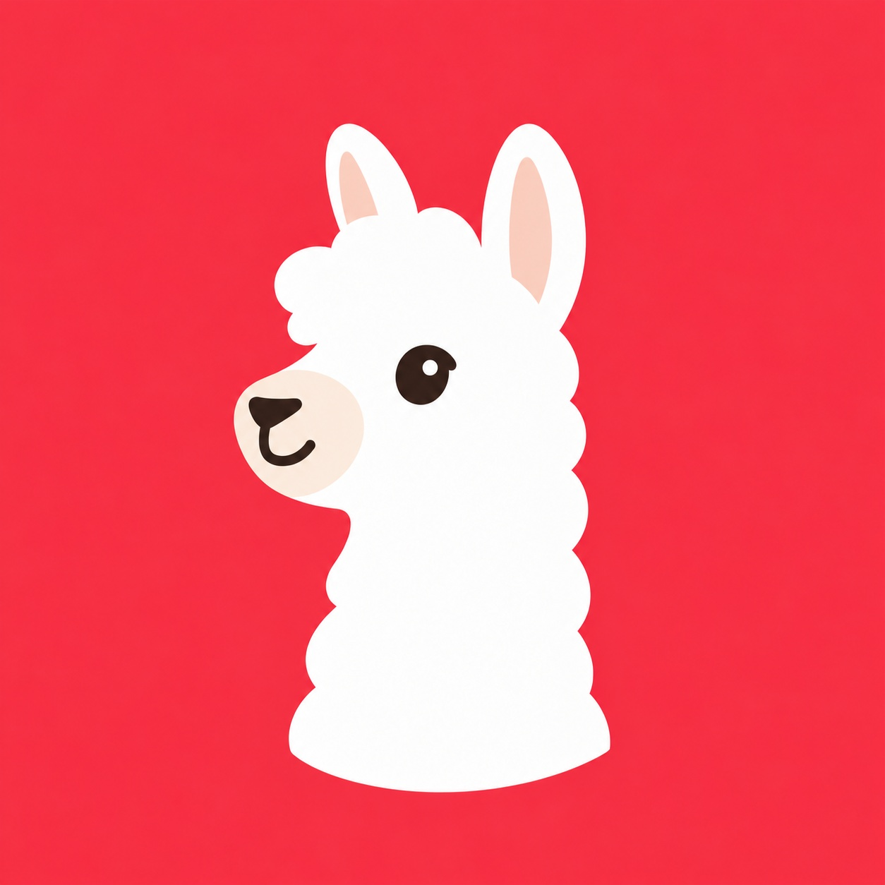

# Nirvana Browser

<p align="center">
  
</p>

<p align="center">
  <strong>Fast. Private. Liberated Browsing.</strong>
</p>

<p align="center">
  <a href="https://github.com/viroaryan/nirvanabrowser/releases"></a>
  <a href="https://www.mozilla.org/en-US/firefox/android/"></a>
  <a href="LICENSE"></a>
  
</p>

---

## 🌟 Overview

**Nirvana Browser** is an open-source, liberated Android web browser built on top of the Mozilla Firefox / Fennec codebase. Designed from the ground up for speed, user sovereignty, and absolute privacy, Nirvana completely strips out invasive telemetry, third-party trackers, ad frameworks, and closed-source dependencies while adding full extension support and a personalized browsing experience.

### 🛡️ Why Nirvana?

* **Zero Telemetry & Tracking**: Removed Google Analytics, Firebase Messaging, Adjust SDK, Google Play In-App Review prompts, and Glean metrics pings.
* **Open Push Notifications**: Uses microG and UnifiedPush instead of proprietary Google Play Services.
* **Pre-bundled uBlock Origin**: Out-of-the-box ad, tracker, and cryptominer blocking via the included uBlock Origin extension.
* **Full Desktop Extension Support**: Unlocked add-on installation policy allowing any compatible WebExtension on mobile.
* **Modern GeckoView 160 Engine**: Fast page load speeds, reliable HTML5/CSS standards rendering, and modern web compatibility.
* **Custom Themes & Wallpapers**: Personalized home screen, custom wallpaper URLs, and convenient bottom toolbar options.
* **100+ Locales Translated**: Complete brand localization across more than 100 languages.

---

## 🏗️ Architecture & How It Works

Rather than duplicating the 50GB+ upstream Firefox repository, this repository follows the lightweight, auditable **distribution patch model** (similar to LibreWolf and Cromite). 

Developers and users can take the official upstream Mozilla Firefox Android source tag (`FIREFOX-ANDROID_160_0_RELEASE`), apply Nirvana's modular patches and assets, and compile an authentic, reproducible Nirvana build.

```
+------------------------------------------------+
|  Upstream Firefox Android Source (160.0.0)     |
+------------------------------------------------+
                       │
                       ▼
+------------------------------------------------+
|  Nirvana Unified Patch & Assets Engine         |
|  - 01-nirvana-core-and-liberate.patch          |
|  - 02-nirvana-branding.patch                   |
|  - 03-nirvana-locales.patch                    |
|  - 04-nirvana-1.0.8-hardened-and-team.patch    |
|  - Bundled Extensions & Visual Assets          |
+------------------------------------------------+
                       │
                       ▼
+------------------------------------------------+
|  Nirvana Browser 1.0.8 (APK & AAB)             |
+------------------------------------------------+
```

---

## 📋 Prerequisites

To build Nirvana Browser from source, ensure your environment has:

| Tool | Version Requirement |
| :--- | :--- |
| **Operating System** | Linux (Ubuntu 22.04+), macOS (13+), or Windows 10/11 (with MSYS2/MozillaBuild) |
| **Java JDK** | OpenJDK 17 (e.g. Eclipse Adoptium Temurin 17) |
| **Android SDK** | API Level 37 (Build-Tools `37.0.0`, Platform `platforms;android-37.2`) |
| **Android NDK** | `29.0.14206865` |
| **Rust** | `1.95.0` or higher |
| **Python** | Python `3.10`+ |

---

## 🚀 Quick Start: Building Nirvana Browser

### 1. Clone the Upstream Firefox Android Repository

```bash
git clone https://github.com/mozilla-mobile/firefox-android.git
cd firefox-android
git checkout FIREFOX-ANDROID_160_0_RELEASE
```

### 2. Clone Nirvana Browser

In an adjacent directory:
```bash
git clone https://github.com/viroaryan/nirvanabrowser.git
```

### 3. Apply Nirvana Patches and Assets

**On Linux / macOS:**
```bash
cd nirvanabrowser
./scripts/apply_patches.sh ../firefox-android
```

**On Windows (PowerShell):**
```powershell
cd nirvanabrowser
.\scripts\apply_patches.ps1 -TargetDir "..\firefox-android"
```

### 4. Build Nirvana Release APK and AAB

**On Linux / macOS:**
```bash
cd ../firefox-android
./mach build
./gradlew :fenix:assembleRelease :fenix:bundleRelease -PdisableDebugSigning
```

**On Windows (PowerShell):**
```powershell
cd ..\firefox-android
.\mach.ps1 build
.\gradlew.bat :fenix:assembleRelease :fenix:bundleRelease -PdisableDebugSigning
```

Your compiled release APK and AAB will be generated in:
`obj/gradle/build/mobile/android/fenix/app/outputs/`

---

## 📁 Repository Structure

```text
nirvanabrowser/
├── .github/
│   ├── ISSUE_TEMPLATE/       # Bug report and feature request templates
│   └── PULL_REQUEST_TEMPLATE.md
├── assets/
│   ├── branding/             # High-resolution logos, mascots, and store banners
│   ├── extensions/           # Pre-packaged uBlock Origin extension (.xpi)
│   └── res/                  # Nirvana adaptive icons, splash screens, and mipmaps
├── patches/
│   ├── 01-nirvana-core-and-liberate.patch        # Telemetry stripping & microG integration
│   ├── 02-nirvana-branding.patch                 # Nirvana App ID, names, and themes
│   ├── 03-nirvana-locales.patch                  # All 100+ language string translations
│   ├── 04-nirvana-1.0.8-hardened-and-team.patch  # Video fixes, anti-fingerprinting & team credits
│   └── nirvana-160.0.0-unified.patch             # All-in-one binary patch
├── scripts/
│   ├── apply_patches.sh / .ps1                   # Automated patch & asset applicator
│   └── build_nirvana.sh / .ps1                   # Build orchestration helper
├── .gitignore
├── LICENSE                         # Mozilla Public License 2.0
└── README.md
```

---

## 👥 Nirvana Core Team

| Name | Role |
| :--- | :--- |
| **Abhiraj Aryan** | **Founder & Creator** |
| **Rahul Kumar Pal** | **Co-Founder** |
| **Priyanshu Singh** | **Designing & UI/UX** |
| **Shivam Giri** | **Advertisement & Growth** |

---

## 🤝 Contributing

We welcome community contributions, bug reports, and pull requests!
1. Fork the repository.
2. Create a feature branch (`git checkout -b feature/amazing-feature`).
3. Commit your modifications.
4. Ensure all builds pass cleanly.
5. Open a Pull Request using the provided template.

---

## 📄 License & Trademarks

* **Source Code**: Released under the **[Mozilla Public License 2.0](LICENSE)** (MPL-2.0).
* **Trademarks & Artwork**: The Nirvana name, logo, and mascot artwork are trademarks of the Nirvana Team.
* **Upstream Acknowledgements**: Nirvana Browser is derived from Firefox Android / Fennec, developed by the Mozilla Foundation and the F-Droid community.
